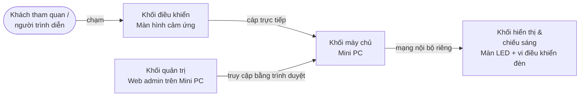
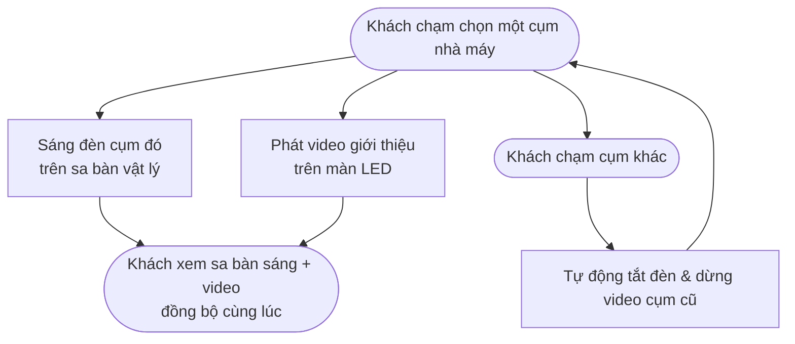

# Thiết kế tổng thể (High-level) — Hệ thống điều khiển sa bàn trình diễn 5 cụm nhà máy

Phiên bản: 0.1 (High-level — dùng giới thiệu với PO/bên quan)
Ngày: 11/11/2026

---

## 1. Mục tiêu giải pháp

Biến sa bàn vật lý thành một phương tiện trình diễn sinh động: khách tham quan chỉ cần chạm vào một cụm nhà máy trên màn hình điều khiển, sa bàn sáng đèn đúng cụm đó và màn LED phát video giới thiệu cụm đó — cùng một thời điểm, thay vì phải giải thích bằng lời.

Giá trị cốt lõi:

- Một chạm là đủ: chọn cụm nhà máy → đèn + video kích hoạt đồng bộ.
- Chuyển cụm tức thì: tắt cụm cũ, bật cụm mới ngay lập tức, không âm thanh/đèn ngắt quãng.
- Tự động chạy khi không có người thao tác (chế độ demo theo lịch).
- Quản trị nội dung dễ dàng: đổi tên, mô tả, video từng cụm không cần động vào phần cứng.

## 2. Nguyên lý vận hành (high-level)

Ba khối độc lập, liên kết đơn giản:

| Khối | Vai trò | Thiết bị |
|---|---|---|
| Khối điều khiển | Giao diện chạm tại bàn, hiển thị sơ đồ 5 cụm nhà máy | Màn hình cảm ứng (kết nối cáp trực tiếp) |
| Khối máy chủ | Bộ não: nhận yêu cầu, điều phối đèn và video | Mini PC đặt trong thân sa bàn |
| Khối hiển thị & chiếu sáng | Phát video giới thiệu và sáng đèn cụm tương ứng | Màn LED + hệ đèn trên sa bàn (điều khiển qua vi điều khiển nhỏ gắn trong sa bàn) |

Người dùng chỉ tiếp xúc với khối điều khiển; hai khối còn lại hoạt động tự động, ẩn sau sa bàn.

## 3. Kiến trúc tổng thể

## 4. Luồng trình diễn (happy path)

## 5. Chức năng chính (gói ngắn cho PO)

1. Điều khiển bằng chạm: sơ đồ 5 cụm nhà máy (Đak Drinh, HELLOW Na, Cà Mau, Nhơn Trạch, Vũng Áng); chọn cụm nào thì đèn cụm đó sáng và video cụm đó phát.
2. Đèn chia mức sáng: 2–3 mức dimmer tùy cấu hình, chỉnh qua web admin.
3. Video loop liên tục: mỗi cụm gắn 1 video giới thiệu; video tự lặp đến khi chuyển cụm.
4. Quản trị nội dung: đổi tên/mô tả/upload video từng cụm, cấu hình mức sáng, xem trạng thái hệ thống theo thời gian thực.
5. Chế độ demo tự động: hệ thống tự chạy lần lượt các cụm theo lịch khi không có người thao tác.
6. Giám sát & vận hành: lịch sử thao tác (log) và trạng thái kết nối của thiết bị điều khiển đèn (online/offline).

## 6. Phạm vi thực hiện / không thực hiện

Thuộc phạm vi hệ thống này:

- Phần mềm: giao diện cảm ứng, máy chủ trung tâm, web admin, ứng dụng điều khiển đèn.
- Phần cứng: Mini PC, màn cảm ứng, màn LED, vi điều khiển đèn, bộ nguồn tập trung, mạng WiFi riêng của hệ thống.

Không thuộc phạm vi (do bên thi công sa bàn đảm nhận):

- Nguồn điện và dải đèn LED 24V đặt dưới các cụm nhà máy.
- Thiết kế dân sự/thẩm mỹ của sa bàn, chi tiết công nghệ đèn 24V.

## 7. Quyết định kỹ thuật chính (cấp high-level)

| Quyết định | Lý do |
|---|---|
| Màn cảm ứng nối cáp trực tiếp với máy chủ | Độ trễ gần như bằng 0, không phụ thuộc mạng, không lo chạm nhầm nội dung sang màn khác |
| Mạng WiFi riêng của hệ thống cho thiết bị điều khiển đèn | Tách khỏi mạng văn phòng: ổn định, bảo mật, không bị ảnh hưởng khi mạng văn phòng thay đổi |
| Thiết bị điều khiển đèn tự chủ động kết nối vào máy chủ | Không cần cấu hình IP tĩnh, thay thiết bị/đổi mạng không phải sửa cấu hình máy chủ |
| Hai màn hình chạy ở chế độ mở rộng (không nhân bản) | Đảm bảo app cảm ứng chỉ hiện trên màn cảm ứng, video chỉ hiện trên màn LED |
| Đèn điều khiển bằng PWM với một vi điều khiển duy nhất | Mượt, nhiều mức sáng, tiết kiệm điện, giảm số linh kiện cần lắp đặt |

## 8. Giả sử & rủi ro

Giả định:

- Mini PC luôn có đủ 2 đầu ra màn hình (một cho màn cảm ứng, một cho màn LED) và đặt cố định trong thân sa bàn.
- Không gian triển lãm/công trình có nguồn điện ổn định cho bộ nguồn tập trung.
- Nội dung video do bên liên quan cung cấp sẵn; hệ thống chỉ phát lại.

Rủi ro & cách giảm thiểu:

| Rủi ro | Giảm thiểu |
|---|---|
| Thiết bị điều khiển đèn mất kết nối WiFi | Web admin hiển thị online/offline; có kế hoạch chạy dự phòng cho đèn cố định khi mất kết nối |
| Nhầm màn hình khi chạy fullscreen | Cấu hình mở rộng + đặt tên màn hình rõ ràng + nghiệm thu bằng cách chạm thử trước khi bàn giao |
| Video định dạng không tương thích | Chuẩn hóa video đầu vào (định dạng/độ phân giải) và hỗ trợ chuyển đổi trước khi đưa vào hệ thống |

## 9. Các mốc đề xuất

1. Khảo sát lắp đặt: xác nhận vị trí đặt thiết bị, nguồn điện, tương thích màn hình/đèn.
2. Triển khai hạ tầng: lắp Mini PC, màn cảm ứng, màn LED, bộ nguồn, thiết bị điều khiển đèn, mạng riêng.
3. Triển khai phần mềm: giao diện cảm ứng, máy chủ, web admin, nhúng nội dung từng cụm.
4. Nghiệm thu: chạm thử từng cụm, chuyển cụm liên tục, chế độ demo tự động, log/lịch sử.
5. Bàn giao & đào tạo vận hành cho người quản trị.

> Ghi chú: đây là bản high-level để thống nhất nhận thức với PO. Thiết kế chi tiết (thiết bị, giao thức, thông số) nằm ở tài liệu "Tài liệu thiết kế hệ thống điều khiển sa bàn quy hoạch tổng thể" (ban đầu do anh Điệp cung cấp).
